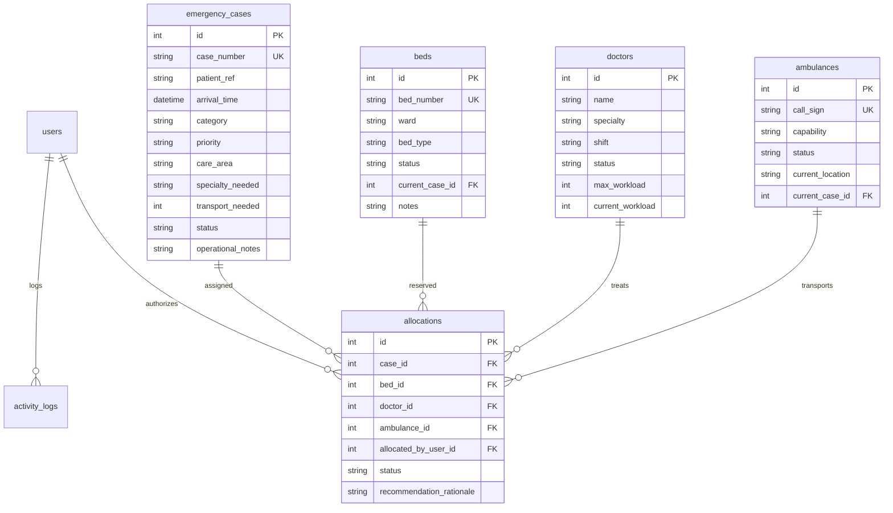

# Smart Hospital Emergency Resource Manager (SHERM)
### HEC Hackathon — Complete Full-Stack Web Application

[](https://opensource.org/licenses/ISC)
[](https://nodejs.org/)
[](https://www.sqlite.org/)
[]()

> **⚠️ OPERATIONAL DEMONSTRATION DISCLAIMER**  
> *The Smart Hospital Emergency Resource Manager (SHERM) is an administrative decision-support platform designed for operational workflow coordination. It uses simulated demonstration data and **never** provides autonomous clinical triage or medically validated diagnoses. Final allocation decisions rest solely with authorized human medical coordinators.*

---

## 1. Project Overview

During mass casualty incidents or emergency department surges, hospital coordinators struggle to balance incoming patients, acute priority queues, bed occupancy, doctor caseloads, and ambulance turnaround times across fragmented tools. 

**SHERM** solves this coordination challenge through a single, centralized command center:
1. **Intake & Triage Directory**: Register emergency cases with pseudonymous references and configurable administrative priority levels.
2. **Transparent Resource Allocation Engine**: Multi-criteria matching algorithm that evaluates ward suitability, doctor specialty compatibility, and workload capacity with explicit plain-language rationale.
3. **Atomic Human-in-the-Loop Confirmation**: Strict database transaction locks and race-condition re-checking ensure resources cannot be double-booked.
4. **Live Command-Center Dashboard**: Real-time status cards, operational queue, and 3 interactive Chart.js visualizations driven by Server-Sent Events (SSE).
5. **Asset Readiness Management**: Ward floor grids for beds, specialty workload meters for doctors, and trip step simulation for ambulances.
6. **Activity & Audit Trail**: Chronological audit logging of all system actions for accountability.

---

## 2. Technology Stack

- **Frontend**:
  - HTML5 & Responsive Semantic Structure
  - Vanilla CSS3 (Custom medical command-center aesthetic, glass cards, micro-animations)
  - Vanilla JavaScript (ES6+ modular client architecture)
  - **Chart.js 4.4+** (Real-time visualizations for beds, doctor workloads, and ambulance fleet readiness)
  - **Server-Sent Events (SSE)** with automatic reconnection watchdog
- **Backend**:
  - **Node.js** & **Express.js 5** RESTful API
  - **better-sqlite3** with Write-Ahead Logging (WAL) and foreign-key constraints
  - **bcryptjs** password hashing (10 salt rounds)
  - **express-session** with secure cookie handling
  - **helmet** HTTP security headers
  - **express-rate-limit** abuse and brute-force protection
- **Testing**:
  - Node.js built-in test runner (`node --test`) and assertion library (`node:assert`)

---

## 3. Demonstration Accounts

SHERM includes pre-seeded demonstration accounts for all three supported operational roles. The login interface features **one-click credential auto-fill buttons** for fast evaluation:

| Role | Username | Password | Operational Permissions |
| :--- | :--- | :--- | :--- |
| **Administrator** | `admin` | `admin123` | System settings, priority weights configuration, audit review, database reset |
| **Emergency Coordinator** | `coordinator` | `coord123` | Case intake, transparent recommendation evaluation, resource assignment authorization |
| **Hospital Staff** | `staff` | `staff123` | Read-only dashboard monitoring, ward floor bed tracking, roster and fleet views |

---

## 4. Quick Start (Windows / PowerShell)

### Prerequisites
- Node.js v18+ (tested on Node.js v24)
- npm

### Installation & Launch

1. **Clone or Open the Project Directory**:
   ```powershell
   cd "c:\Users\inaam\OneDrive - Higher Education Commission\Desktop\Hecathone 26 w"
   ```

2. **Verify Dependencies**:
   ```powershell
   npm.cmd install
   ```

3. **Run the Automated Test Suite**:
   ```powershell
   npm.cmd test
   ```
   *Executes 10 unit and integration tests across the allocation engine, race-condition validation, and REST API endpoints.*

4. **Start the Application Server**:
   ```powershell
   npm.cmd start
   ```

5. **Access the Web Dashboard**:
   Open your browser and navigate to:  
   👉 **`http://localhost:3000`**

---

## 5. System Architecture & Features

### 1. Command Center Dashboard
- **Metric Cards**: Real-time totals for Active Cases, Bed Occupancy %, On-Duty Physicians, and Ready Ambulances.
- **Resource Shortage Banner**: Dynamic warning banners trigger if available beds, physicians, or ambulances drop below critical safety thresholds.
- **Urgent Priority Queue**: Real-time operational table sorted by administrative priority score (Critical = 100, High = 75) and arrival timestamp.
- **3 Interactive Chart.js Visualizations**:
  - *Bed Occupancy by Care Area*: Stacked bar chart (Available vs Occupied vs Out of Service across Emergency Dept, Trauma Bay, ICU, Step-Down, and Observation).
  - *Physician Capacity by Specialty*: Horizontal workload bar chart showing active assigned patients versus maximum capacity limits.
  - *Ambulance Fleet Status*: Doughnut chart detailing readiness distribution.

### 2. Emergency Case Registration
- Clinical intake form generating pseudonymous patient references (`PT-XXXX-X`) and unique case identifiers (`CAS-YYYY-XXXX`).
- Selectable clinical category, required care area, requested specialty, and transport requirement flags.
- Operational non-diagnostic notes.

### 3. Transparent Resource Allocation Engine
The backend engine (`src/services/allocationEngine.js`) evaluates:
1. **Priority Ordering**: Higher administrative score evaluated first; arrival time serves as tiebreaker.
2. **Bed Suitability**: Identifies unallocated beds matching the requested care area. If primary ward is full, recommends a compatible adjacent unit or flags a shortage.
3. **Physician Suitability**: Filters by specialty, shift, and ensures strict enforcement of workload capacity (`current_workload < max_workload`). Selects physician with lowest current load.
4. **Ambulance Suitability**: If transport was requested, matches available vehicles by capability (Advanced Life Support, Basic Life Support, Critical Care Transport).
5. **Plain-Language Explainability**: Formulates clear rationale sentences detailing *why* each resource was chosen.
6. **Atomic Human Confirmation**: The operator reviews the rationale, can accept or adjust recommendations, and authorizes the assignment. The backend rechecks resource availability inside an atomic SQLite transaction to prevent race conditions.

### 4. Bed Management & Floor Grid
- Interactive visual floor grid grouped by hospital wards.
- Color-coded borders indicating Available (Green), Occupied (Amber), and Out of Service (Gray).
- Table view toggle, quick status updater, and bed release controls.

### 5. Physician & Staff Roster
- Staff cards tracking specialty, shift, and live workload meters.
- Modal to register new physicians and update shift availability.

### 6. Ambulance Fleet & Trip Progression
- Vehicle capability tracking with simulated location checkpoints.
- **"Simulate Step" Button**: Progresses vehicle status step-by-step:  
  `Available` ➔ `Dispatched` ➔ `En Route` ➔ `At Hospital` ➔ `Available` (with simulated location updates).

### 7. Activity & Audit Trail with Direct CSV Export
- Chronological immutable log of all logins, registrations, status updates, allocations, and administrative changes.
- **"Export Log"**: Downloads a clean formatted `sherm_audit_log_YYYY-MM-DD.csv` file directly to the client machine.

### 8. System Settings, Surge Simulation & Baseline Demo Reset
- Configurable administrative priority weights and labels.
- **"⚡ Simulate Surge Influx"**: Injects 3 simulated mass casualty admissions and demonstrates live SSE queue updates and reallocation.
- **"🖨️ Print Clinical Handover Sheet"**: Generates a clean medical handover sheet formatted for clinical shift change.
- **"Reset Hospital Demo Data"**: Restores pristine hackathon baseline data (14 cases, 24 beds, 10 doctors, 6 ambulances) after confirmation.

---

## 6. Database Schema

The database (`hospital.db`) is initialized idempotently on startup with normalized relational tables:



---

## 7. REST API Reference

| Method | Endpoint | Description | Role Required |
| :--- | :--- | :--- | :--- |
| `POST` | `/api/auth/login` | Authenticate user & start session | Public (Rate Limited) |
| `POST` | `/api/auth/logout` | Terminate session & clear cookies | Public |
| `GET` | `/api/auth/me` | Fetch active authenticated user | Public |
| `GET` | `/api/dashboard/summary` | Aggregate metric cards & shortage alerts | Public |
| `GET` | `/api/dashboard/charts` | Chart aggregations for beds, doctors, ambulances | Public |
| `GET` | `/api/dashboard/urgent-queue` | Priority-ordered operational queue | Public |
| `GET` | `/api/dashboard/stream` | Server-Sent Events (SSE) live stream | Public |
| `GET` | `/api/cases` | Search, filter, and paginate emergency cases | Public |
| `GET` | `/api/cases/:id` | Detailed case record with assignment history | Public |
| `POST` | `/api/cases` | Register new emergency case | Coordinator, Admin |
| `POST` | `/api/cases/:id/close` | Discharge case & release all resources | Coordinator, Admin |
| `GET` | `/api/beds` | Query beds by ward and availability | Public |
| `POST` | `/api/beds` | Add bed to inventory | Coordinator, Admin |
| `POST` | `/api/beds/:id/release` | Release bed back to Available pool | Coordinator, Admin |
| `GET` | `/api/doctors` | List doctors with workload & shift details | Public |
| `POST` | `/api/doctors` | Add doctor to staff roster | Admin |
| `GET` | `/api/ambulances` | List ambulance fleet units | Public |
| `POST` | `/api/ambulances/:id/simulate-step` | Advance simulated trip progression | Coordinator, Admin |
| `POST` | `/api/allocations/recommend` | Generate transparent matching recommendation | Authenticated |
| `POST` | `/api/allocations/confirm` | Atomic allocation confirmation & reservation | Coordinator, Admin |
| `GET` | `/api/allocations/history` | Review past and active allocation decisions | Authenticated |
| `GET` | `/api/settings/priorities` | Fetch configurable priority weights | Public |
| `PATCH` | `/api/settings/priorities` | Update priority scores & badge colors | Admin |
| `POST` | `/api/settings/reset-demo` | Restore original demonstration database | Admin |
| `GET` | `/api/audit-logs` | Filter and paginate immutable audit logs | Authenticated |
